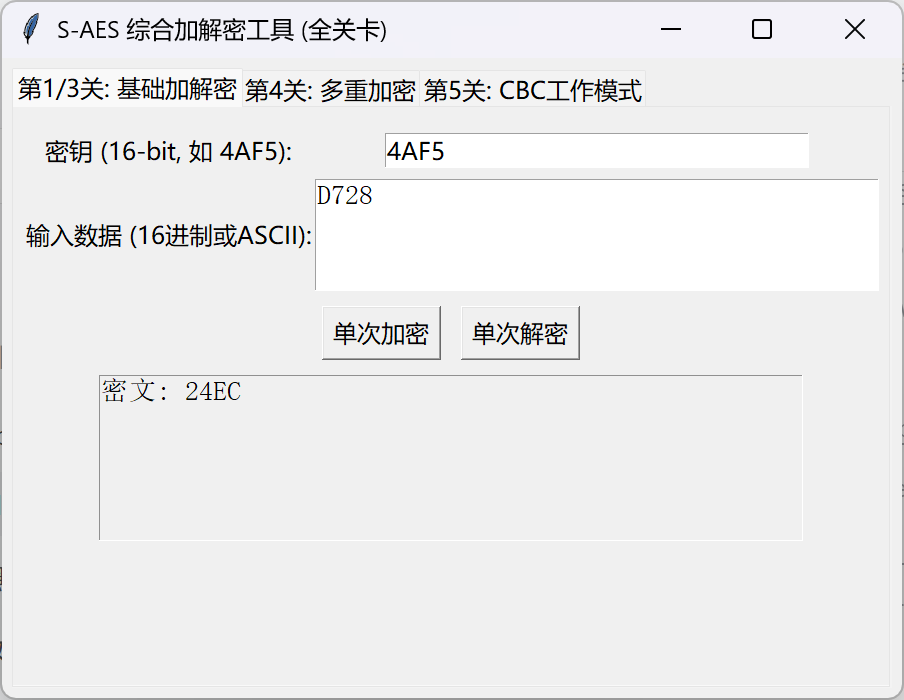
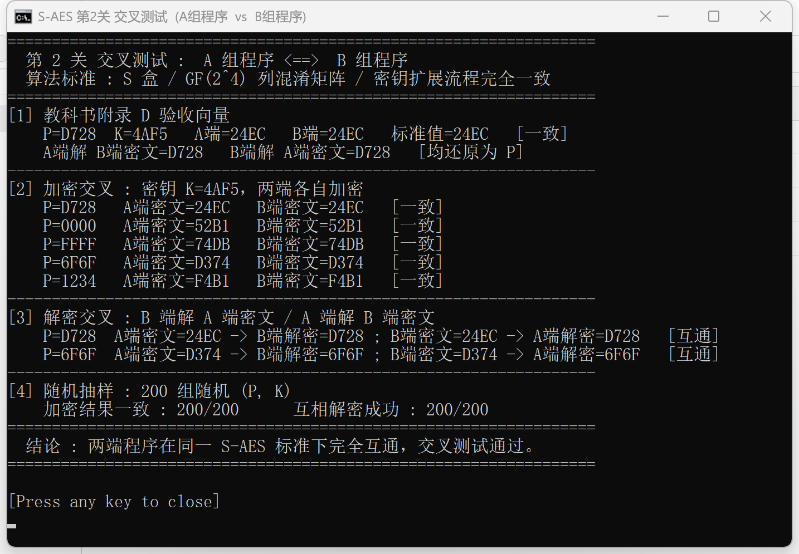
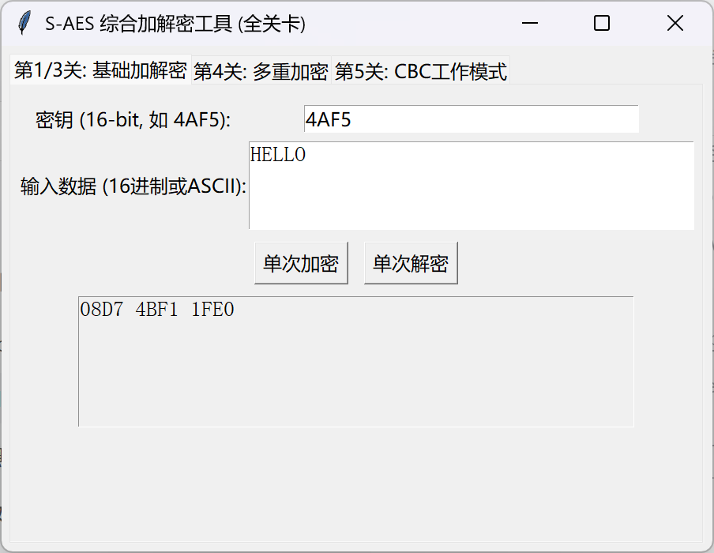
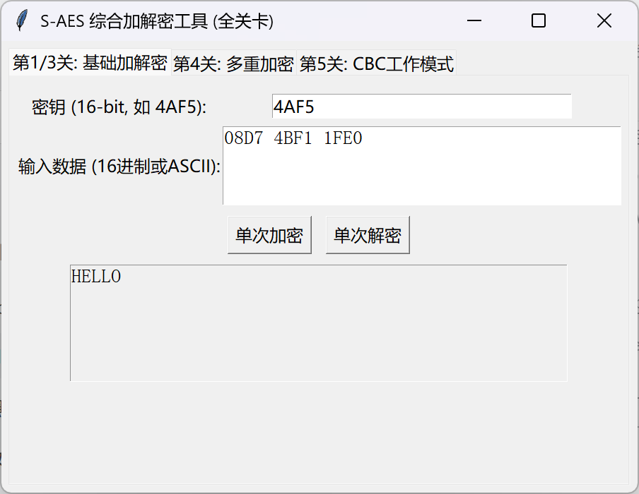
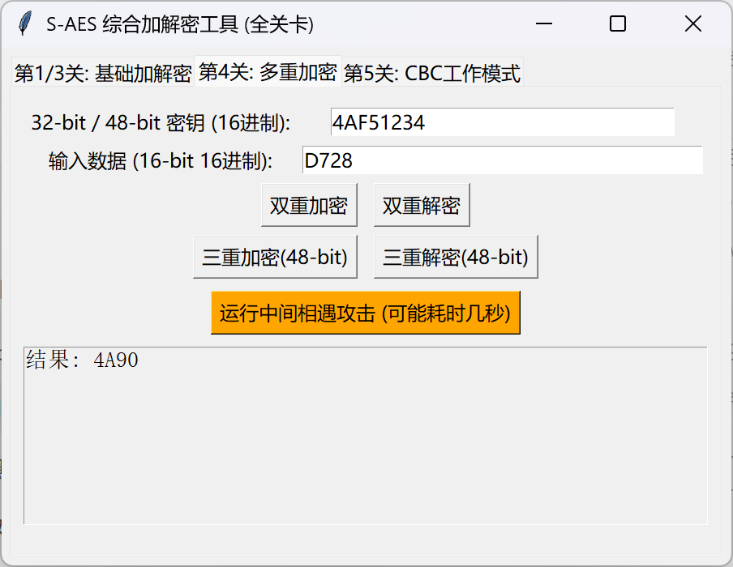
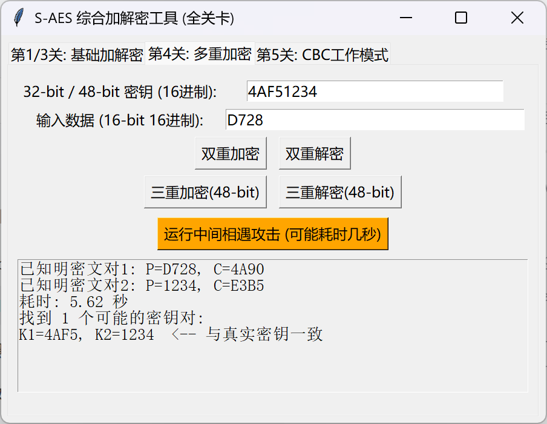
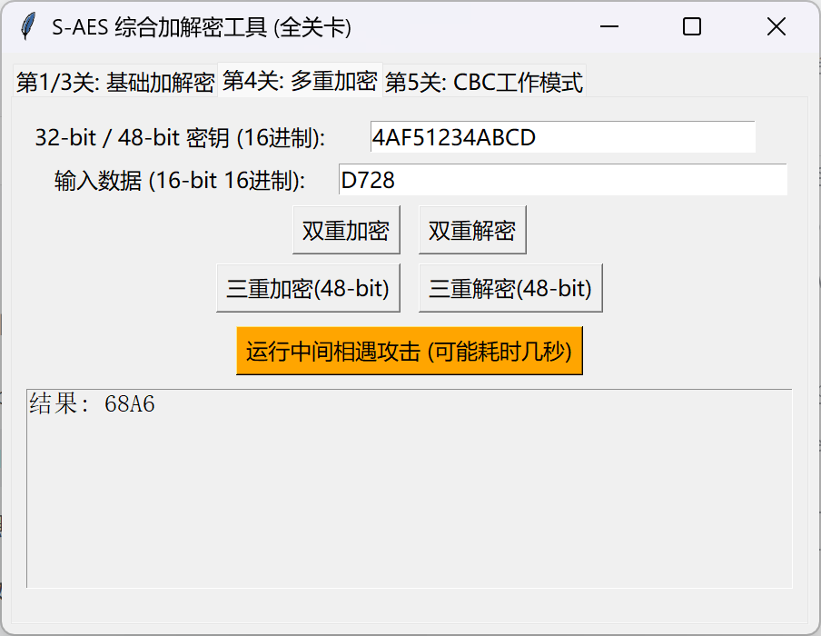
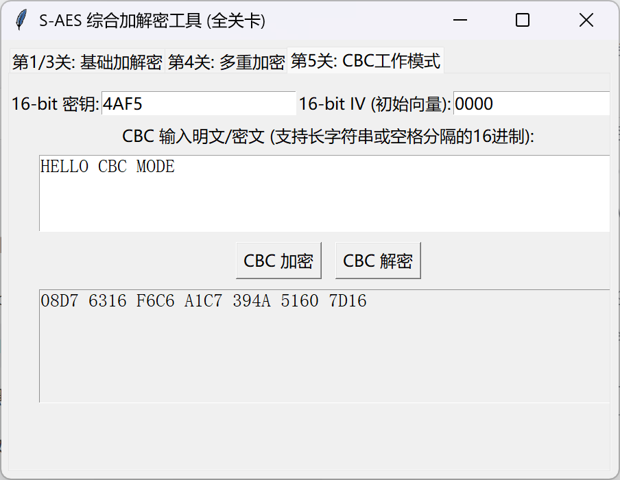
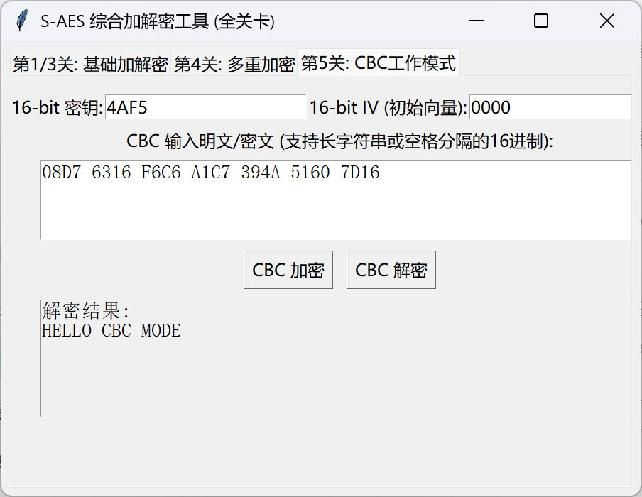

# S-AES 加解密程序 —— 测试结果

| 项目 | 内容 |
| --- | --- |
| 课程 | 信息安全导论（第 8-9 次课作业） |
| 算法 | 简化 AES（S-AES），依据《密码编码学与网络安全——原理与实践（第 8 版）》附录 D |
| 运行环境 | Windows 11 + Python 3.13 + tkinter 8.6（仅标准库，无第三方依赖） |
| 测试日期 | 2026-10-18 |
| 数据约定 | 分组、密钥均为 16 bit，统一用 4 位十六进制表示（如 `D728`）；多重加密密钥为 8 位/12 位十六进制（如 `4AF51234`） |

本文档所有截图均来自实际运行的程序界面，图片存放于 [`screenshots/`](screenshots/)。

---

## 0. 测试总览

| 关卡 | 测试内容 | 关键数据 | 结果 |
| --- | --- | --- | --- |
| 第 1 关 | 16 bit 数据 + 16 bit 密钥的 GUI 加解密 | `D728` + `4AF5` → `24EC` | 通过 |
| 第 2 关 | 交叉测试：A 组程序 / B 组程序 | 5 组固定明文 + 200 组随机抽样 | 通过 |
| 第 3 关 | ASCII 字符串按 2 字节分组加解密 | `HELLO` → `08D7 4BF1 1FE0` | 通过 |
| 第 4 关 4.1 | 双重加密（32 bit 密钥 K1+K2） | `4AF51234` + `D728` → `4A90` | 通过 |
| 第 4 关 4.2 | 中间相遇攻击恢复密钥 | 2 对明密文 → `K1=4AF5, K2=1234` | 通过 |
| 第 4 关 4.3 | 三重加密（48 bit 密钥 K1+K2+K3） | `4AF51234ABCD` + `D728` → `68A6` | 通过 |
| 第 5 关 | CBC 工作模式 + 密文篡改对比 | 14 字节明文 → 7 个密文块 | 通过 |

---

## 1. 第 1 关：基本测试

**测试目的**：验证 16 bit 明文 + 16 bit 密钥的标准 S-AES 加解密流程，并确认 GUI 交互可用。

**测试步骤**

1. 启动 `gui/app.py`，进入「第1/3关：基础加解密」选项卡；
2. 密钥填入 `4AF5`，输入数据填入 `D728`，点击「单次加密」；
3. 把得到的密文 `24EC` 放回输入框，点击「单次解密」。

**测试结果**

| 操作 | 密钥 K | 输入 | 输出 |
| --- | --- | --- | --- |
| 加密 | `4AF5` | 明文 `D728` | 密文 `24EC` |
| 解密 | `4AF5` | 密文 `24EC` | 明文 `D728` |

加密结果与教材附录 D 的标准测试向量一致，解密可完整还原明文。




---

## 2. 第 2 关：交叉测试

**测试目的**：验证不同实现（异构程序）在同一 S-AES 标准下可以互通——相同密钥加密同一明文得到相同密文，一端的密文可被另一端正确解密。

**测试方法**

- **A 端**：本组提交的程序（`saes/core.py`，位运算实现）；
- **B 端**：另一小组的 S-AES 程序。双方约定同一个 16 bit 密钥 `K=4AF5`，各自加密同一批明文，
  再互换密文解密；另做 200 组随机 (P, K) 抽样比对。B 端源码属于对方小组的作业，不随本仓库提交，
  本仓库只保留运行结果（见下方截图）；
- 两端实现遵循同一算法标准：S 盒、GF(2⁴) 约简多项式 x⁴+x+1、列混淆矩阵、轮常数 0x80/0x30 完全一致。

**测试结果**

| 类别 | 内容 | A 端 | B 端 | 结论 |
| --- | --- | --- | --- | --- |
| 教材向量 | `P=D728, K=4AF5` | `24EC` | `24EC` | 一致（= 标准值 `24EC`） |
| 加密交叉 | `P=0000, K=4AF5` | `52B1` | `52B1` | 一致 |
| 加密交叉 | `P=FFFF, K=4AF5` | `74DB` | `74DB` | 一致 |
| 加密交叉 | `P=6F6F, K=4AF5` | `D374` | `D374` | 一致 |
| 加密交叉 | `P=1234, K=4AF5` | `F4B1` | `F4B1` | 一致 |
| 解密交叉 | A 端密文 → B 端解密 | `24EC` → `D728` | — | 还原成功 |
| 解密交叉 | B 端密文 → A 端解密 | — | `24EC` → `D728` | 还原成功 |
| 随机抽样 | 200 组随机 (P, K) | — | — | 加密一致 200/200，互相解密成功 200/200 |



> 开发自测补充：核心算法另做过一次穷举自检——65536 个密钥 × 6 组明文共 393216 次加密，
> 加密结果全部能正确解密还原，说明算法流程与替换盒、列混淆矩阵的选取符合标准。

---

## 3. 第 3 关：扩展功能（ASCII 字符串）

**测试目的**：把数据输入扩展为 ASCII 编码字符串，按 2 字节（16 bit）分组加密；密文以十六进制分组输出。

**测试步骤**

1. 「第1/3关」选项卡中密钥填 `4AF5`；
2. 输入数据填 `HELLO`（5 个字符），点击「单次加密」；
3. 将输出的密文块原样粘回输入框，点击「单次解密」。

**测试结果**

| 方向 | 输入 | 输出 |
| --- | --- | --- |
| 加密 | `HELLO`（5 字节，奇数长度末尾补 1 个 `0x00`，共 3 个分组） | `08D7 4BF1 1FE0` |
| 解密 | `08D7 4BF1 1FE0` | `HELLO`（补齐用的空字符已过滤） |

分组对应关系：`HE` → `08D7`，`LL` → `4BF1`，`O` + 补零 → `1FE0`。





---

## 4. 第 4 关：多重加密

### 4.1 双重加密（32 bit 密钥）

**加密定义**：`C = Enc(K2, Enc(K1, P))`，其中 `K = K1 || K2`。

| 操作 | 密钥 K（32 bit） | 输入 | 输出 |
| --- | --- | --- | --- |
| 双重加密 | `4AF51234`（K1=`4AF5`, K2=`1234`） | 明文 `D728` | 密文 `4A90` |
| 双重解密 | `4AF51234` | 密文 `4A90` | 明文 `D728` |




### 4.2 中间相遇攻击

**攻击思路**

双重加密的密钥空间是 2³²，直接穷举不可行。中间相遇攻击把它拆成两次 2¹⁶ 的穷举：

1. 正向：枚举全部 65536 个 K1，计算中间值 `M = Enc(K1, P)`，建立「中间值 → K1 列表」的表；
2. 反向：枚举全部 65536 个 K2，计算 `M' = Dec(K2, C)`，在表中查找 `M' = M` 的碰撞；
3. 凡是碰撞上的 (K1, K2) 都是候选密钥。

**测试结果**

| 项目 | 内容 |
| --- | --- |
| 已知明密文对 1 | `P= D728`，`C= 4A90` |
| 已知明密文对 2 | `P= 1234`，`C= E3B5` |
| 攻击耗时 | 约 5.6 秒（2×65536 次 S-AES 运算） |
| 候选密钥对个数 | 1 |
| 恢复结果 | `K1=4AF5, K2=1234`，与真实密钥完全一致 |

> **为什么需要两对明密文**：分组只有 16 bit，中间值最多 2¹⁶ 种。实测 65536 个 K1 只产生 41510 个不同中间值，
> 反向枚举 65536 个 K2 时几乎每个都能在表中找到碰撞，因此单对明密文会得到 65522 个候选（真实密钥只是其中之一），
> 无法唯一定位；加入第二对明密文复核后候选降到 1 个。这正是分组过短导致"碰撞过多"的必然结果，
> 也说明 S-AES 只适合教学演示。



### 4.3 三重加密（48 bit 密钥 K1+K2+K3 模式）

**加密定义**：`C = Enc(K3, Dec(K2, Enc(K1, P)))`，密钥为 48 bit，分组仍为 16 bit。

| 操作 | 密钥 K（48 bit） | 输入 | 输出 |
| --- | --- | --- | --- |
| 三重加密 | `4AF51234ABCD`（K1=`4AF5`, K2=`1234`, K3=`ABCD`） | 明文 `D728` | 密文 `68A6` |
| 三重解密 | `4AF51234ABCD` | 密文 `68A6` | 明文 `D728` |




---

## 5. 第 5 关：工作模式（CBC）

**测试目的**：用密码分组链（CBC）模式加密较长的明文消息，并对比篡改密文前后的解密结果。

**CBC 公式**：`C_i = Enc(K, P_i ⊕ C_{i-1})`，`C_0 = IV`（16 bit 初始向量，加解密双方共享）。

**测试参数**

| 参数 | 取值 |
| --- | --- |
| 密钥 K | `4AF5` |
| 初始向量 IV | `0000`（双方约定相同 IV；实际使用中应随机生成并随密文一起安全传递） |
| 明文 | `HELLO CBC MODE`（14 字节 → 7 个分组） |

### 5.1 正常加解密

| 方向 | 数据 |
| --- | --- |
| 明文 | `HELLO CBC MODE` |
| 密文 | `08D7 6316 F6C6 A1C7 394A 5160 7D16` |
| 解密结果 | `HELLO CBC MODE` |





### 5.2 密文篡改对比

将第 2 个密文块 `6316` 改成 `6317`（只翻转最后 1 个比特），其余密文块不变，再次解密：

| 项目 | 内容 |
| --- | --- |
| 篡改后的密文 | `08D7 6317 F6C6 A1C7 394A 5160 7D16` |
| 解密结果 | `HE<NO!CBC MODE`（原明文为 `HELLO CBC MODE`） |

**结果对比**

| 明文分组 | 原始明文 | 篡改后解密 | 现象 |
| --- | --- | --- | --- |
| 第 1 块 | `HE` | `HE` | 未受影响 |
| 第 2 块 | `LL` | `<N` | 完全变成乱码 |
| 第 3 块 | `O `（O + 空格） | `O!` | 对应比特被翻转（空格 0x20 → `!` 0x21） |
| 第 4-7 块 | `CBC MODE` | `CBC MODE` | 未受影响 |

**结论**

1. 被篡改的密文块解密后完全乱码，且篡改会"传染"到下一块（因为下一块的解密要异或这个密文块），
   但再往后的分组不受影响——这正是 CBC 的错误传播特性；
2. 仅靠 CBC 无法发现篡改，程序仍会"正常"输出乱码明文，因此实际系统还需要 MAC/HMAC 或
   AEAD 模式来保证完整性；


（上图是把 `6316` 改为 `6317` 后的解密结果：第 2 块乱码、第 3 块比特翻转，其余分组正常。）

---

## 6. 测试向量汇总（可直接复核）

| # | 模式 | 密钥 | 输入 | 输出 |
| --- | --- | --- | --- | --- |
| 1 | S-AES 加密 | `4AF5` | `D728` | `24EC` |
| 2 | S-AES 解密 | `4AF5` | `24EC` | `D728` |
| 3 | S-AES 加密（ASCII） | `4AF5` | `HELLO`（补零到 6 字节） | `08D7 4BF1 1FE0` |
| 4 | S-AES 解密（ASCII） | `4AF5` | `08D7 4BF1 1FE0` | `HELLO` |
| 5 | 双重加密 | `4AF51234` | `D728` | `4A90` |
| 6 | 双重解密 | `4AF51234` | `4A90` | `D728` |
| 7 | 三重加密 | `4AF51234ABCD` | `D728` | `68A6` |
| 8 | 三重解密 | `4AF51234ABCD` | `68A6` | `D728` |
| 9 | CBC 加密 | `4AF5`，IV=`0000` | `HELLO CBC MODE` | `08D7 6316 F6C6 A1C7 394A 5160 7D16` |
| 10 | CBC 解密 | `4AF5`，IV=`0000` | 上表密文 | `HELLO CBC MODE` |
| 11 | CBC 解密（篡改） | `4AF5`，IV=`0000` | 第 2 块改为 `6317` | `HE<NO!CBC MODE` |

## 7. 复现方式

```bash
# 1) 启动 GUI（三个选项卡分别对应第 1/3 关、第 4 关、第 5 关）
python gui/app.py

# 2) 教材标准向量自测
python tests/test_core.py
```

第 2 关的交叉测试在对方小组的程序上完成，双方各自运行、比对结果（见上方截图），
对方源码不属于本仓库内容。

## 8. 结论

5 个关卡的全部要求均已实现并通过测试：核心 S-AES 算法与教材附录 D 的标准向量一致，
两份独立实现可交叉加解密；ASCII、双重/三重加密、中间相遇攻击与 CBC 模式均工作正常；
密文篡改实验复现了 CBC 的错误传播现象，说明还需要完整性保护机制。
